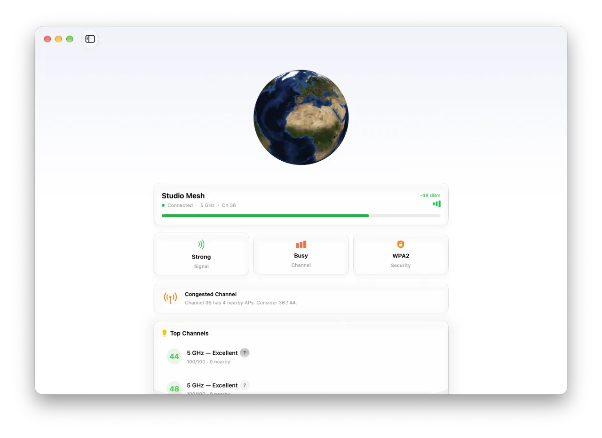
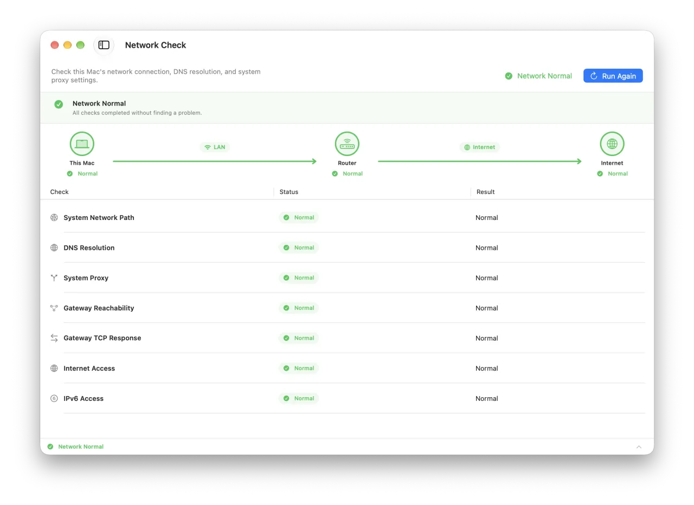

# WiFi Lens Pro

**看清 Wi-Fi 正在发生什么。**

原生 macOS Wi-Fi 分析与网络诊断应用。实时排查连接问题、按需持续观测，并在问题消失后回顾历史证据。

<p align="center">
  <a href="https://apps.apple.com/app/apple-store/id6776590746?pt=128979395&ct=github_readme&mt=8"></a>
</p>

<p align="center"><a href="https://wifi-lens.shiinalabs.com/zh-Hans/?utm_source=github&amp;utm_medium=readme&amp;utm_campaign=github_readme">官方网站</a></p>

<p align="center"></p>

<p align="center"><sub>macOS 14.6+ · Intel &amp; Apple Silicon · One-time purchase</sub></p>

---

<p align="center">
  <a href="README.md">🇺🇸 English</a> · <a href="README.de.md">🇩🇪 Deutsch</a> · <a href="README.es-ES.md">🇪🇸 Español</a> · <a href="README.fr.md">🇫🇷 Français</a> · 🇨🇳 简体中文 · <a href="README.ja.md">🇯🇵 日本語</a> · <a href="README.zh-Hant.md">🇭🇰 繁體中文</a>
</p>

<p align="center">
  <a href="#为什么选择-wifi-lens-pro">Pro 价值</a> · <a href="#核心能力">实时工具</a> · <a href="#版本">版本</a>
</p>

---

## 为什么选择 WiFi Lens Pro

网络异常不一定会在你打开检测工具时再次出现。WiFi Lens Pro 将实时分析、网络诊断与历史调查结合在一起，让你既能检查当前连接，也能回看此前发生的情况。

### 现在发生了什么

查看附近的 Wi-Fi 网络和信道拥堵情况，连接异常时运行网络检查。实时 Wi-Fi 分析和网络诊断构成了 Pro 完整工作流的基础。

### 需要时持续观察

通过菜单栏查看当前连接信息。可选的后台观测能在 Pro 应用关闭后继续运行；默认关闭，Mac 进入睡眠后会暂停。

### 事后调查，而不是猜测

Network Experience 帮助评估观测期间的网络可靠性。Historical Baseline 将已保存的网关延迟与兼容的历史基准比较，Problem History 则汇总已记录的问题及其支持证据，供后续调查。

<table>
<tr>
<td width="50%" align="center"><sub>Historical Baseline</sub></td>
<td width="50%" align="center"><sub>Problem History</sub></td>
</tr>
</table>

<p align="center"><a href="https://apps.apple.com/app/apple-store/id6776590746?pt=128979395&ct=github_readme&mt=8"><strong>获取 WiFi Lens Pro</strong></a></p>

---

## 核心能力

Pro 同样包含日常排障需要的实时工具：

- **Wi-Fi 分析** — 扫描 2.4、5 和 6 GHz 附近网络，比较信号、信道活动、拥堵、安全性和区域信道建议。
- **Network Check 网络检查** — 检查从 Mac、局域网到互联网的连接路径，包括网关可达性、DNS、HTTP/HTTPS、可选 IPv6 和代理路由。
- **其他本地工具** — 漫游与信道热力图、AP Radar、本地 MCP 集成和图表导出。本仓库也提供这些实时工具的免费开源版。

<p align="center"></p>
<p align="center"></p>

---

## 版本

### WiFi Lens Pro
WiFi Lens Pro 可通过 [Mac App Store](https://apps.apple.com/app/apple-store/id6776590746?pt=128979395&ct=github_readme&mt=8) 一次性购买。它增加了菜单栏状态、Network Experience、Problem History、频谱录制、可选的后台观测，以及面向运营商场景的 Wi-Fi Calling Test。Historical Baseline 是 Network Experience 中的一个视图。

### 开源版

WiFi Lens OSS 免费且开源。你可以通过 [GitHub Releases](https://github.com/ShiinaLabs/wifi-lens/releases/latest)、Homebrew 或源代码获取实时 Wi-Fi 分析和本地网络诊断。

| 能力 | WiFi Lens Pro | 开源版 |
|------|---------------|--------|
| 实时 Wi-Fi 分析 | ✅ | ✅ |
| 网络诊断 | ✅ | ✅ |
| 信道推荐 | ✅ | ✅ |
| MCP 集成 | ✅ | ✅ |
| 菜单栏状态 | ✅ | — |
| Network Experience 与 Historical Baseline | ✅ | — |
| Problem History | ✅ | — |
| 频谱录制 | ✅ | — |
| 可选的后台观测 | ✅ | — |
| Wi-Fi Calling Test | ✅ | — |

两个版本都在 Mac 上处理 Wi-Fi 扫描数据。Pro 增加了历史分析、频谱录制、可选后台观测和 Wi-Fi Calling Test。

---

## AI / MCP 集成


WiFi Lens 提供可选的本地 MCP 服务器。启用后，兼容客户端可以从这台 Mac 请求实时 Wi-Fi 扫描数据。可在 Codex Desktop 或 Claude Desktop 等 MCP 客户端中进行配置。

```json
{
  "mcpServers": {
    "wifi-lens": {
      "url": "http://127.0.0.1:19840"
    }
  }
}
```

手动配置时，请使用客户端要求的格式：

```toml
# Codex：~/.codex/config.toml
[mcp_servers.wifi-lens]
url = "http://127.0.0.1:19840/"
```

```json
// Claude Desktop 及其他基于 JSON 的客户端
{
  "mcpServers": {
    "wifi-lens": {
      "url": "http://127.0.0.1:19840/"
    }
  }
}
```

连接后，你可以问 AI 助手“附近哪些信道比较拥堵？”或“附近哪些网络支持 WPA3？”。MCP 服务器仅在 `127.0.0.1` 上监听；连接的客户端或模型服务可能按其自身政策和配置处理收到的数据。

更多示例请参考 [AI 工作流指南](https://wifi-lens.shiinalabs.com/zh-Hans/ai-mcp/?utm_source=github&utm_medium=readme&utm_campaign=github_readme)。

---

## 开源版
WiFi Lens OSS 免费且开源，可用于本地实时分析、开发、查看源码和参与社区贡献。

- **GitHub Releases** — [下载最新版本](https://github.com/ShiinaLabs/wifi-lens/releases/latest)
- **Homebrew** — `brew tap ShiinaLabs/apps && brew install --cask ShiinaLabs/apps/wifi-lens`
- **源码与文档** — 浏览本仓库和[架构文档](docs/)

<details>
<summary>开源版功能</summary>

| 能力 | 说明 | 状态 |
|------|------|------|
| 📡 Wi-Fi 扫描 | 跨 2.4 / 5 / 6 GHz 频段的实时扫描 | 稳定 |
| 📊 频谱视图 | 高斯曲线展示信道占用 | 稳定 |
| 🎯 信道质量 | 拥堵评分与区域推荐 | 稳定 |
| 🔍 网络详情 | PHY 代际、信道宽度、802.11k/r/v、WPA3 | 稳定 |
| 📶 连接信息 | IP、网关、DNS、MAC、发送速率和安全摘要 | 稳定 |
| 🚶 漫游测试 | AP 切换监控与会话保存/加载 | 稳定 |
| 🗺️ 信道热力图 | 各频段占用热力图 | 稳定 |
| 🎧 BLE 扫描器 | Bluetooth LE 设备发现、RSSI 分析和追踪 | 稳定 |
| 🎨 智能着色 | 基于 SSID 的确定性颜色分配 | 稳定 |
| 🌐 MCP 服务器 | 用于 AI 工具集成的内嵌 HTTP API | 稳定 |
| 📤 导出 | 将图表保存为 PNG 或 CSV | 稳定 |
| 🔒 隐私优先 | 无遥测；扫描数据保留在 Mac 上 | 稳定 |
| ⬆️ 自动更新 | GitHub 版使用 Sparkle | 稳定 |
| 🌍 本地化 | 英语、法语、德语、日语、俄语、西班牙语、简体中文和繁体中文 | 稳定 |
| 🩺 Network Self-Check | 检查连接、DNS、HTTPS、IPv6 和已配置的代理 | 稳定 |
| 📻 AP Radar | 追踪选定 AP，并提供音频脉冲反馈 | 预览 |
| 📜 开源许可证 | 在“设置 → 关于”中查看已包含的组件、许可证和声明 | 稳定 |

</details>

[](https://github.com/ShiinaLabs/wifi-lens/releases/latest)
[](https://github.com/ShiinaLabs/wifi-lens/releases/latest)
[](LICENSE)

---

## 隐私
WiFi Lens 不会将 Wi-Fi 扫描记录上传至应用服务，也不收集使用分析或遥测数据。

- **定位服务：** macOS 需要此权限才能提供 Wi-Fi SSID 名称。WiFi Lens 不读取 GPS 位置。
- **区域检测：** 在设备上使用系统语言设置、硬件上报的信道列表和附近 AP 的国家代码。
- **Network Self-Check：** 会向公共目标发送诊断探测，并在适用时探测已配置的代理。诊断证据保存在本地。
- **MCP 服务器：** 可选功能，仅绑定到 `127.0.0.1`。连接的客户端和模型服务会根据各自政策与配置处理收到的数据。
- **后台观测：** Pro 中的可选功能，默认关闭。观测数据保存在本地；Mac 进入睡眠后会暂停采集。
- **更新检查：** GitHub 版在你请求检查更新或启用自动检查时联系 GitHub。

📋 [安全策略](SECURITY.md) · 📝 [更新日志](https://github.com/ShiinaLabs/wifi-lens/releases) · ❓ [常见问题](https://wifi-lens.shiinalabs.com/zh-Hans/faq/?utm_source=github&utm_medium=readme&utm_campaign=github_readme) · 🌐 [完整隐私政策](https://wifi-lens.shiinalabs.com/zh-Hans/privacy/?utm_source=github&utm_medium=readme&utm_campaign=github_readme)

---

## 获取 WiFi Lens

需要 **macOS 14.6（Sonoma）或更高版本**。支持 Intel 和 Apple Silicon。6 GHz 扫描需要 Wi-Fi 6E/7 硬件。

### WiFi Lens Pro
WiFi Lens Pro 在实时 Wi-Fi 分析基础上增加菜单栏状态、Network Experience、Problem History、频谱录制、可选后台观测，以及面向运营商场景的 Wi-Fi Calling Test。前往 [Mac App Store](https://apps.apple.com/app/apple-store/id6776590746?pt=128979395&ct=github_readme&mt=8) 获取。

<p align="center">
  <a href="https://apps.apple.com/app/apple-store/id6776590746?pt=128979395&ct=github_readme&mt=8"></a>
</p>

### 开源版

适合 GitHub 分发和社区开发：

- [GitHub Releases](https://github.com/ShiinaLabs/wifi-lens/releases/latest)
- Homebrew：`brew tap ShiinaLabs/apps && brew install --cask ShiinaLabs/apps/wifi-lens`
- 源码：本仓库

> [!IMPORTANT]
> 在 macOS 14.6+ 上，必须启用**定位服务**，应用才能读取 Wi-Fi SSID 名称。请前往**系统设置 → 隐私与安全性 → 定位服务**，并在系统提示时启用 WiFi Lens。

---

## 开发

```sh
git clone https://github.com/ShiinaLabs/wifi-lens
cd wifi-lens
git submodule update --init ChartLens
cd WiFiLens

# Build
xcodebuild -project WiFiLens.xcodeproj -scheme "WiFi Lens" \
  -configuration Debug -destination 'platform=macOS' build

# Run unit tests
xcodebuild -project WiFiLens.xcodeproj -scheme "WiFi Lens" \
  -configuration Debug -destination 'platform=macOS' \
  -skipPackageUpdates test -only-testing:WiFiLensTests -only-testing:WiFiLensCoreTests
```

架构文档位于 [docs/](docs/)。

---

## 贡献

欢迎提交问题报告、功能想法和改进建议。请参阅[贡献指南](.github/CONTRIBUTING.md)，了解环境设置、PR 约定和本地化要求。

欢迎加入 **[Rabbit Hole](https://discord.gg/gH6sTCYaJ7)**，这里是 WiFi Lens 和其他项目的小型社区。

**联系：** [X 上的 @WiFiLens](https://x.com/WiFiLens) · [contacts@shiinalabs.com](mailto:contacts@shiinalabs.com)

---

## 许可证

本项目 Fork 自 [tiny-wifi-analyzer](https://github.com/nolze/tiny-wifi-analyzer)。MAC 厂商数据来自 [IEEE Registration Authority](https://standards.ieee.org/products-programs/regauth/)，详见[第三方声明](docs/THIRD-PARTY-NOTICES.md)。

Apache License 2.0 © 2020 nolze, 2026 ShiinaLabs — 详见 [LICENSE](LICENSE)。
