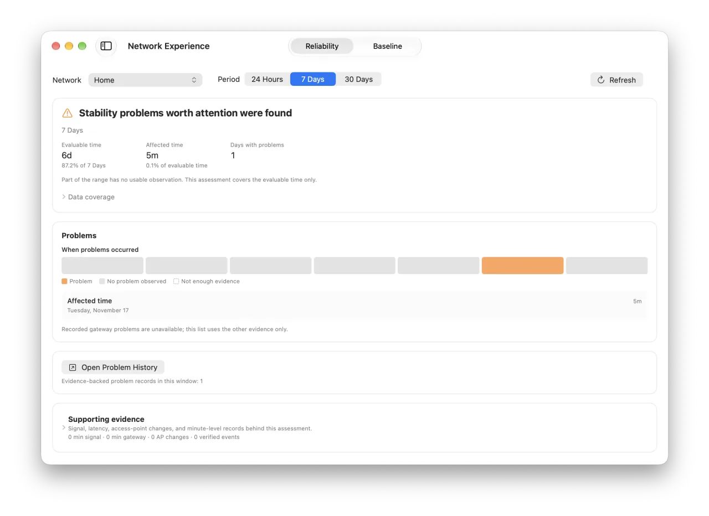
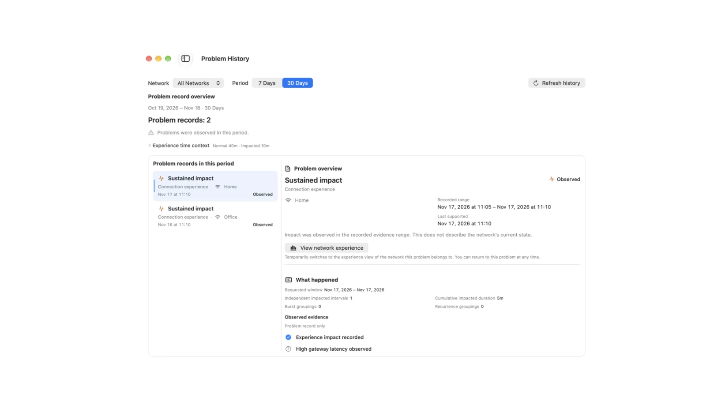

# WiFi Lens Pro

**了解 Wi-Fi 正在發生什麼。**

原生 macOS Wi-Fi 分析與網路診斷 App。即時排查連線問題、按需持續觀測，並在問題消失後回顧歷史證據。

<p align="center">
  <a href="https://apps.apple.com/app/apple-store/id6776590746?pt=128979395&ct=github_readme&mt=8"></a>
</p>

<p align="center"><a href="https://wifi-lens.shiinalabs.com/?utm_source=github&amp;utm_medium=readme&amp;utm_campaign=github_readme">官方網站</a></p>

<p align="center"></p>

<p align="center"><sub>macOS 14.6+ · Intel &amp; Apple Silicon · One-time purchase</sub></p>

---

<p align="center">
  <a href="README.md">🇺🇸 English</a> · <a href="README.de.md">🇩🇪 Deutsch</a> · <a href="README.es-ES.md">🇪🇸 Español</a> · <a href="README.fr.md">🇫🇷 Français</a> · <a href="README.zh-Hans.md">🇨🇳 简体中文</a> · <a href="README.ja.md">🇯🇵 日本語</a> · 🇭🇰 繁體中文
</p>

<p align="center">
  <a href="#為什麼選擇-wifi-lens-pro">Pro 功能</a> · <a href="#核心功能">即時工具</a> · <a href="#版本">版本</a>
</p>

---

## 為什麼選擇 WiFi Lens Pro

網路異常不一定會在你開啟診斷工具時再次出現。WiFi Lens Pro 將即時分析、網路診斷與歷史調查結合，讓你能檢查目前連線，也能回顧過去發生的情況。

### 了解現在的連線狀態

查看附近的 Wi-Fi 網路與信道壅塞情況，連線異常時執行網路檢查。即時 Wi-Fi 分析與網路診斷是 Pro 完整工作流程的一部分。

### 需要時持續觀測

透過選單列查看目前連線資訊。可選的背景觀測可在關閉 Pro App 後繼續執行；預設關閉，Mac 進入睡眠後暫停。

### 用記錄調查過去的問題

Network Experience 協助評估觀測期間的網路可靠性。Historical Baseline 將已儲存的閘道器延遲與相容的歷史基準比較，Problem History 則彙整已記錄的問題及支持證據，方便後續調查。

<table>
<tr>
<td width="50%" align="center"><sub>Historical Baseline</sub></td>
<td width="50%" align="center"><sub>Problem History</sub></td>
</tr>
</table>

<p align="center"><a href="https://apps.apple.com/app/apple-store/id6776590746?pt=128979395&ct=github_readme&mt=8"><strong>取得 WiFi Lens Pro</strong></a></p>

---

## 核心功能

Pro 亦包含日常排障所需的即時工具：

- **Wi-Fi 分析** — 掃描 2.4、5 和 6 GHz 附近網路，比較訊號、信道活動、壅塞、安全性與區域信道建議。
- **Network Check 網路檢查** — 檢查從 Mac、區域網路到網際網路的連線路徑，包括閘道器可達性、DNS、HTTP/HTTPS、可選 IPv6 與代理路由。
- **其他本機工具** — 漫遊與信道熱度圖、AP Radar、本機 MCP 整合及圖表匯出。本儲存庫亦提供這些即時工具的免費開放原始碼版。

<p align="center"></p>
<p align="center"></p>

---

## 版本

### WiFi Lens Pro
WiFi Lens Pro 可透過 [Mac App Store](https://apps.apple.com/app/apple-store/id6776590746?pt=128979395&ct=github_readme&mt=8) 一次購買。它增加了選單列狀態、Network Experience、Problem History、頻譜記錄、可選的背景觀測，以及面向電信業者情境的 Wi-Fi Calling Test。Historical Baseline 是 Network Experience 中的檢視項目。

### 開放原始碼版

WiFi Lens OSS 免費且開放原始碼。你可以透過 [GitHub Releases](https://github.com/ShiinaLabs/wifi-lens/releases/latest)、Homebrew 或原始碼取得即時 Wi-Fi 分析和本機網路診斷。

| 功能 | WiFi Lens Pro | 開放原始碼版 |
|------|---------------|--------------|
| 即時 Wi-Fi 分析 | ✅ | ✅ |
| 網路診斷 | ✅ | ✅ |
| 信道建議 | ✅ | ✅ |
| MCP 整合 | ✅ | ✅ |
| 選單列狀態 | ✅ | — |
| Network Experience 與 Historical Baseline | ✅ | — |
| Problem History | ✅ | — |
| 頻譜記錄 | ✅ | — |
| 可選的背景觀測 | ✅ | — |
| Wi-Fi Calling Test | ✅ | — |

兩個版本都在 Mac 上處理 Wi-Fi 掃描資料。Pro 增加歷史分析、頻譜記錄、可選的背景觀測和 Wi-Fi Calling Test。

---

## AI / MCP 整合


WiFi Lens 提供可選的本機 MCP 伺服器。啟用後，相容用戶端可以從這部 Mac 要求即時 Wi-Fi 掃描資料。可在 Codex Desktop 或 Claude Desktop 等 MCP 用戶端中設定。

```json
{
  "mcpServers": {
    "wifi-lens": {
      "url": "http://127.0.0.1:19840"
    }
  }
}
```

手動設定時，請使用用戶端要求的格式：

```toml
# Codex: ~/.codex/config.toml
[mcp_servers.wifi-lens]
url = "http://127.0.0.1:19840/"
```

```json
// Claude Desktop and other JSON-based clients
{
  "mcpServers": {
    "wifi-lens": {
      "url": "http://127.0.0.1:19840/"
    }
  }
}
```

連線後，你可以詢問 AI 助理「附近哪些信道比較壅塞？」或「附近哪些網路支援 WPA3？」。MCP 伺服器只會在 `127.0.0.1` 上監聽；連線的用戶端或模型服務可能依照自身政策與設定處理收到的資料。

更多範例請參閱 [AI 工作流程指南](https://wifi-lens.shiinalabs.com/ai-mcp/?utm_source=github&utm_medium=readme&utm_campaign=github_readme)。

---

## 開放原始碼版
WiFi Lens OSS 免費且開放原始碼，可用於本機即時分析、開發、檢視原始碼和社群協作。

- **GitHub Releases** — [下載最新版本](https://github.com/ShiinaLabs/wifi-lens/releases/latest)
- **Homebrew** — `brew tap ShiinaLabs/apps && brew install --cask ShiinaLabs/apps/wifi-lens`
- **原始碼與文件** — 瀏覽本儲存庫和[架構文件](docs/)

<details>
<summary>開放原始碼版功能</summary>

| 功能 | 說明 | 狀態 |
|------|------|------|
| 📡 Wi-Fi 掃描 | 即時掃描 2.4 / 5 / 6 GHz 頻段 | 穩定 |
| 📊 頻譜檢視 | 以高斯曲線呈現信道使用狀況 | 穩定 |
| 🎯 信道品質 | 壅塞評分和依地區提供的建議 | 穩定 |
| 🔍 網路詳細資訊 | PHY 世代、信道寬度、802.11k/r/v、WPA3 | 穩定 |
| 📶 連線資訊 | IP、閘道器、DNS、MAC、傳送速率和安全性摘要 | 穩定 |
| 🚶 漫遊測試 | 監測 AP 切換並儲存／載入工作階段 | 穩定 |
| 🗺️ 信道熱度圖 | 各頻段的使用率熱度圖 | 穩定 |
| 🎧 BLE 掃描器 | Bluetooth LE 裝置探索、RSSI 分析和追蹤 | 穩定 |
| 🎨 智慧著色 | 依 SSID 決定顏色，結果一致 | 穩定 |
| 🌐 MCP 伺服器 | 整合 AI 工具的內嵌 HTTP API | 穩定 |
| 📤 匯出 | 將圖表儲存為 PNG 或 CSV | 穩定 |
| 🔒 隱私優先 | 不含遙測；掃描資料保留在 Mac 上 | 穩定 |
| ⬆️ 自動更新 | GitHub 版本使用 Sparkle | 穩定 |
| 🌍 本地化 | 英文、法文、德文、日文、俄文、西班牙文、簡體中文和繁體中文 | 穩定 |
| 🩺 Network Self-Check | 檢查連線、DNS、HTTPS、IPv6 和已設定的代理伺服器 | 穩定 |
| 📻 AP Radar | 追蹤選取的 AP，並提供音訊脈衝回饋 | 預覽 |
| 📜 開放原始碼授權 | 在「設定 → 關於」檢視內含元件、授權和聲明 | 穩定 |

</details>

[](https://github.com/ShiinaLabs/wifi-lens/releases/latest)
[](https://github.com/ShiinaLabs/wifi-lens/releases/latest)
[](LICENSE)

---

## 隱私權
WiFi Lens 不會將 Wi-Fi 掃描記錄上傳至應用程式服務，也不會收集使用分析資料或遙測。

- **定位服務：** macOS 需要此權限才能提供 Wi-Fi SSID 名稱。WiFi Lens 不會讀取 GPS 位置。
- **地區偵測：** 在裝置上參考系統語言設定、硬體回報的信道清單和附近 AP 的國碼。
- **Network Self-Check：** 會向公開目標傳送診斷探測，並在適用時測試已設定的代理伺服器。診斷證據會儲存在本機。
- **MCP 伺服器：** 為選用功能，僅繫結至 `127.0.0.1`。連線的用戶端和模型服務會依照各自政策與設定處理收到的資料。
- **背景觀測：** Pro 中的選用功能，預設為關閉。觀測資料會儲存在本機；Mac 進入睡眠後會暫停收集。
- **檢查更新：** GitHub 版本只會在你手動檢查更新或啟用自動檢查時連線至 GitHub。

📋 [安全性政策](SECURITY.md) · 📝 [更新紀錄](https://github.com/ShiinaLabs/wifi-lens/releases) · ❓ [常見問題](https://wifi-lens.shiinalabs.com/faq/?utm_source=github&utm_medium=readme&utm_campaign=github_readme) · 🌐 [完整隱私權政策](https://wifi-lens.shiinalabs.com/privacy/?utm_source=github&utm_medium=readme&utm_campaign=github_readme)

---

## 取得 WiFi Lens

需要 **macOS 14.6（Sonoma）或更新版本**。支援 Intel 和 Apple Silicon。掃描 6 GHz 需要 Wi-Fi 6E/7 硬體。

### WiFi Lens Pro
WiFi Lens Pro 在即時 Wi-Fi 分析之外，增加選單列狀態、Network Experience、Problem History、頻譜記錄、可選的背景觀測，以及面向電信業者情境的 Wi-Fi Calling Test。請至 [Mac App Store](https://apps.apple.com/app/apple-store/id6776590746?pt=128979395&ct=github_readme&mt=8) 下載。

<p align="center">
  <a href="https://apps.apple.com/app/apple-store/id6776590746?pt=128979395&ct=github_readme&mt=8"></a>
</p>

### 開放原始碼版

適合 GitHub 發行和社群開發：

- [GitHub Releases](https://github.com/ShiinaLabs/wifi-lens/releases/latest)
- Homebrew：`brew tap ShiinaLabs/apps && brew install --cask ShiinaLabs/apps/wifi-lens`
- 原始碼：本儲存庫

> [!IMPORTANT]
> 在 macOS 14.6 或更新版本中，App 必須取得**定位服務**權限，才能讀取 Wi-Fi SSID 名稱。請前往**系統設定 → 隱私權與安全性 → 定位服務**，並在系統提示時啟用 WiFi Lens。

---

## 開發

```sh
git clone https://github.com/ShiinaLabs/wifi-lens
cd wifi-lens
git submodule update --init ChartLens
cd WiFiLens

# Build
xcodebuild -project WiFiLens.xcodeproj -scheme "WiFi Lens" \
  -configuration Debug -destination 'platform=macOS' build

# Run unit tests
xcodebuild -project WiFiLens.xcodeproj -scheme "WiFi Lens" \
  -configuration Debug -destination 'platform=macOS' \
  -skipPackageUpdates test -only-testing:WiFiLensTests -only-testing:WiFiLensCoreTests
```

架構文件位於 [docs/](docs/)。

---

## 參與貢獻

歡迎回報問題、提出功能構想和改進建議。請參閱[貢獻指南](.github/CONTRIBUTING.md)，瞭解環境設定、PR 慣例和本地化要求。

歡迎加入 **[Rabbit Hole](https://discord.gg/gH6sTCYaJ7)**，這裡是 WiFi Lens 和其他專案的交流社群。

**聯絡方式：** [X 上的 @WiFiLens](https://x.com/WiFiLens) · [contacts@shiinalabs.com](mailto:contacts@shiinalabs.com)

---

## 授權條款

本專案 fork 自 [tiny-wifi-analyzer](https://github.com/nolze/tiny-wifi-analyzer)。MAC 廠商資料來自 [IEEE Registration Authority](https://standards.ieee.org/products-programs/regauth/)，詳情請參閱[第三方聲明](docs/THIRD-PARTY-NOTICES.md)。

Apache License 2.0 © 2020 nolze, 2026 ShiinaLabs — 詳見 [LICENSE](LICENSE)。
