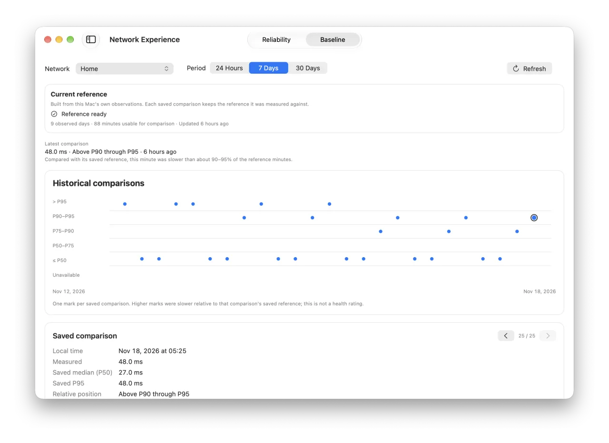

<h1 align="center">WiFi Lens Pro</h1>

<p align="center"><strong>看清 Wi-Fi 正在發生什麼。</strong></p>
<p align="center">原生 macOS Wi-Fi 分析與網路診斷 App。<br>即時排查連線問題、按需持續觀測，並利用歷史證據調查反覆出現的異常。</p>
<p align="center"><a href="https://apps.apple.com/app/apple-store/id6776590746?pt=128979395&ct=github_readme&mt=8"></a></p>
<p align="center">
  
  
  
</p>
<p align="center"><a href="https://wifi-lens.shiinalabs.com/zh-Hans/?utm_source=github&amp;utm_medium=readme&amp;utm_campaign=github_readme">官方網站</a> &nbsp;·&nbsp; 一次性購買</p>
<p align="center"></p>
<p align="center"><sub>Network Experience · 根據實際觀測評估網路可靠性</sub></p>

---

<p align="center"><a href="README.md">🇺🇸 English</a> · <a href="README.de.md">🇩🇪 Deutsch</a> · <a href="README.es-ES.md">🇪🇸 Español</a> · <a href="README.fr.md">🇫🇷 Français</a> · <a href="README.zh-Hans.md">🇨🇳 简体中文</a> · <a href="README.ja.md">🇯🇵 日本語</a> · <strong>🇭🇰 繁體中文</strong></p>

## Wi-Fi 問題不會等你準備好

Wi-Fi 可能突然斷線、延遲突然升高，或連線過一會兒又自行恢復。等你準備好要排查時，問題可能早已消失。

**WiFi Lens Pro 不只協助你檢查目前的網路，也能在需要時持續觀測，讓反覆發生的問題留下可供調查的證據。**

| **🔍 01 · 即時排查** | **📡 02 · 持續觀測** | **🗂️ 03 · 歷史調查** |
|:---|:---|:---|
| 了解目前連線與無線環境 | 在需要時持續收集觀測結果 | 回顧可靠性、歷史基準與問題證據 |
| [查看網路診斷](#01--即時排查) | [了解持續觀測](#02--持續觀測) | [查看歷史調查](#03--歷史調查) |

---

## 01 · 即時排查

### 先確認問題可能出在哪裡

使用 **Network Check**，分別檢查 **This Mac、LAN、Internet** 三個階段的連線路徑。你可以查看閘道、DNS、HTTP/HTTPS、選用的 IPv6，以及已設定的代理伺服器檢查結果，區分已確認的問題與證據不足的情況。

如果問題可能與無線環境有關，**Wi-Fi 分析**會顯示附近 2.4 / 5 / 6 GHz 網路、訊號強度、頻道使用與壅塞情況、安全性資訊，以及依地區提供的頻道建議。

<table>
<tr>
<td width="50%" align="center"><sub>Network Check · 分階段檢查連線</sub></td>
<td width="50%" align="center"><sub>Wi-Fi 分析 · 查看周遭無線環境</sub></td>
</tr>
</table>

這兩項即時功能也包含在免費開源版中。Pro 在此基礎上提供持續觀測與歷史調查工作流程。

---

## 02 · 持續觀測

### 不必守在螢幕前等待問題再次發生

有些異常只會持續幾秒。與其不斷開啟掃描器，不如在需要時持續觀測網路，並保留日後可以回顧的紀錄。

| 功能 | 可以做什麼 |
|---|---|
| **選單列狀態** | 查看目前連線、閘道狀態、近期變化與短期趨勢。 |
| **Continuous Observation** | 可選擇在 Pro App 關閉後繼續收集受支援的網路觀測結果。預設關閉；Mac 進入睡眠時會暫停。 |
| **Spectrum → Recording** | 錄製選定 AP 的訊號變化，之後可以儲存並重新載入紀錄以供檢視。 |

---

## 03 · 歷史調查

### 問題可能已經消失，但留下的證據仍然有價值

Pro 的歷史功能以 **Network Experience** 和 **Problem History** 為核心，讓你沿著已記錄的證據繼續調查，而不必自行解讀一堆彼此無關的圖表。

**網路可靠性（Network Experience → Reliability）**

選擇網路與時間範圍，查看根據現有證據形成的可靠性評估，包括偵測到的問題及其發生時間。觀測涵蓋不足的時段，不會被當成網路正常的證明。

**歷史基準（Network Experience → Baseline）**

將已儲存的閘道延遲測量值與相容的歷史基準比較。這能呈現有證據支持的相對變化；單次偏差本身並不足以證明網路故障。

**問題紀錄（Problem History）**

查看已儲存的問題紀錄、佐證資料與後續觀測結果。當發現有足夠證據支持時，可以依照建議進入相應工具執行下一步檢查；檢查仍由使用者主動執行。

<table>
<tr>
<td width="50%" align="center"><sub>Historical Baseline · 比較符合條件的歷史測量值</sub></td>
<td width="50%" align="center"><sub>Problem History · 回顧已記錄的問題與證據</sub></td>
</tr>
</table>

<p align="center"><strong>檢查目前狀態、持續觀測，並在事後進行調查。</strong></p>
<p align="center">這就是 WiFi Lens Pro 的完整體驗。</p>
<p align="center"><a href="https://apps.apple.com/app/apple-store/id6776590746?pt=128979395&ct=github_readme&mt=8"><strong>取得 WiFi Lens Pro</strong></a></p>

---

## 更多實用工具

除了上述工作流程，WiFi Lens 也提供漫遊測試、頻道熱圖、AP Radar、Bluetooth LE 掃描、圖表匯出與本機 MCP 整合。

WiFi Lens Pro 另提供適用於電信業者情境的 **Wi-Fi Calling Test**，支援業者預設值或自訂 MCC/MNC。

## Pro 與開源版

免費開源版提供即時 Wi-Fi 分析與本機網路診斷。**WiFi Lens Pro** 則在此基礎上增加持續觀測、歷史分析與問題調查能力。

| 功能 | Pro | 開源版 |
|---|:---:|:---:|
| Wi-Fi 分析、頻道品質與建議 | ✓ | ✓ |
| Network Check | ✓ | ✓ |
| 漫遊測試、AP Radar、頻道熱圖 | ✓ | ✓ |
| 本機 MCP、圖表匯出 | ✓ | ✓ |
| 選單列狀態與持續觀測 | ✓ | — |
| 網路可靠性與歷史基準 | ✓ | — |
| 問題紀錄與歷史調查 | ✓ | — |
| 頻譜錄製、Wi-Fi Calling Test | ✓ | — |

<p align="center"><a href="https://apps.apple.com/app/apple-store/id6776590746?pt=128979395&ct=github_readme&mt=8">取得 WiFi Lens Pro</a> &nbsp;·&nbsp; <a href="https://github.com/ShiinaLabs/wifi-lens/releases/latest">下載免費開源版</a></p>

---

## 隱私與資料

WiFi Lens 在 Mac 本機處理 Wi-Fi 掃描資料，不需要帳號、不使用雲端同步，也不收集使用遙測資料。

- **Network Check：** 會連線至公開的診斷目標，並在適用時檢查已設定的代理伺服器。
- **Continuous Observation：** 預設關閉。觀測資料保存在 Mac 本機，Mac 進入睡眠時會暫停收集。
- **本機 MCP：** 伺服器僅繫結至 `127.0.0.1`。如果 AI 用戶端連線至外部服務，請另外確認該用戶端的資料處理方式。
- **系統權限：** macOS 要求 App 取得定位服務權限才能讀取 Wi-Fi SSID；WiFi Lens 不會讀取 GPS 位置。

詳見 [完整隱私權政策](https://wifi-lens.shiinalabs.com/zh-Hans/privacy/?utm_source=github&utm_medium=readme&utm_campaign=github_readme).

## 取得 WiFi Lens

**WiFi Lens Pro:** 透過 [Mac App Store](https://apps.apple.com/app/apple-store/id6776590746?pt=128979395&ct=github_readme&mt=8) 一次性購買。需要 macOS 14.6+，支援 Intel 與 Apple Silicon；6 GHz 掃描需要 Wi-Fi 6E/7 硬體。

**WiFi Lens 開源版:** 可從 [GitHub Releases](https://github.com/ShiinaLabs/wifi-lens/releases/latest) 或 Homebrew 取得：

<p>
<a href="https://github.com/ShiinaLabs/wifi-lens/releases/latest"></a>
<a href="https://github.com/ShiinaLabs/wifi-lens/releases/latest"></a>
<a href="LICENSE"></a>
</p>

```sh
brew tap ShiinaLabs/apps
brew install --cask ShiinaLabs/apps/wifi-lens
```

<details>
<summary><strong>AI / MCP：整合與設定</strong></summary>

WiFi Lens 提供可選用的本機 MCP 伺服器。啟用後，相容的 AI 工具可以讀取即時 Wi-Fi 掃描資料，例如附近的頻道使用情況與網路安全資訊。

伺服器僅繫結至 `127.0.0.1`。MCP 用戶端設定範例：

```json
{
  "mcpServers": {
    "wifi-lens": {
      "url": "http://127.0.0.1:19840/"
    }
  }
}
```

Codex 設定：

```toml
[mcp_servers.wifi-lens]
url = "http://127.0.0.1:19840/"
```

更多範例請參閱 [AI 工作流程指南](https://wifi-lens.shiinalabs.com/zh-Hans/ai-mcp/?utm_source=github&utm_medium=readme&utm_campaign=github_readme).

</details>

<details>
<summary><strong>開發與貢獻</strong></summary>

```sh
git clone https://github.com/ShiinaLabs/wifi-lens
cd wifi-lens

xcodebuild -project WiFiLens.xcodeproj -scheme "WiFi Lens" \
  -configuration Debug -destination 'platform=macOS' build

xcodebuild -project WiFiLens.xcodeproj -scheme "WiFi Lens" \
  -configuration Debug -destination 'platform=macOS' \
  -skipPackageUpdates test -only-testing:WiFiLensTests -only-testing:WiFiLensCoreTests
```

架構文件位於 [docs/](docs/)。歡迎參閱[貢獻指南](.github/CONTRIBUTING.md)，回報問題、提出改進建議或提交 PR。

</details>

## 社群與授權

加入 [Rabbit Hole](https://discord.gg/gH6sTCYaJ7)，與大家討論 WiFi Lens 和其他專案。

**聯絡方式：** [@WiFiLens](https://x.com/WiFiLens) · [contacts@shiinalabs.com](mailto:contacts@shiinalabs.com)

本專案 Fork 自 [tiny-wifi-analyzer](https://github.com/nolze/tiny-wifi-analyzer)。MAC 廠商資料來自 [IEEE Registration Authority](https://standards.ieee.org/products-programs/regauth/)，詳見[第三方聲明](docs/THIRD-PARTY-NOTICES.md)。

Apache License 2.0 © 2020 nolze, 2026 ShiinaLabs — 詳見 [LICENSE](LICENSE).
